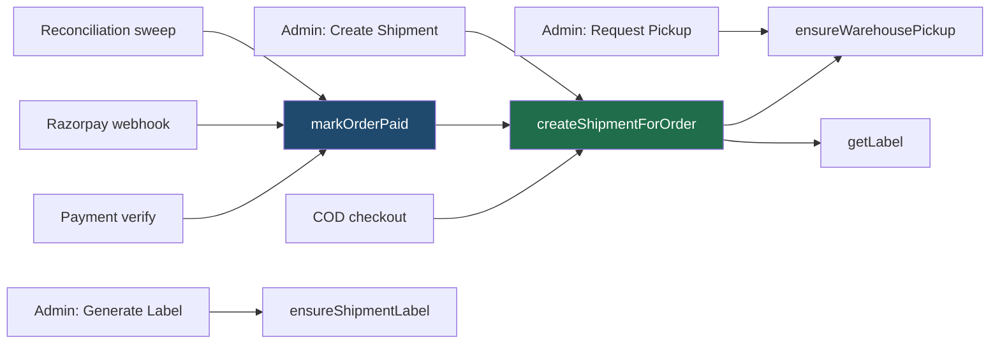

# Entry points

Every path that can cause a shipment to be booked. There are six. All of them
converge on the same three service functions, which is why the safety gate lives
inside those functions rather than at each call site — see
[06](06-failure-and-safety.md#the-safety-gate).



## The six

| # | Entry point | Source | Live today? |
|---|---|---|---|
| 1 | COD checkout | `customer.routes.ts` — after order creation | ✅ **yes** |
| 2 | Customer payment verification | `customer.routes.ts` → `markOrderPaid` | ⚠️ dormant |
| 3 | Razorpay webhook | `webhooks.routes.ts` → `markOrderPaid` | ⚠️ dormant |
| 4 | Reconciliation sweep | `webhooks.routes.ts` → `markOrderPaid` | ⚠️ dormant |
| 5 | Admin "Create Shipment" | `admin.routes.ts` | ✅ yes (retry only) |
| 6 | Admin "Request Pickup" / "Generate Label" | `admin.routes.ts` | ✅ yes (retry only) |

Entries 2–4 are **dormant because Razorpay is not configured in production** —
no online payment can complete, so nothing reaches `markOrderPaid`. The code
path is correct and tested; it is simply unreachable until payments are
configured. See [07](07-configuration.md).

## 1. COD checkout — the live path

```ts
// customer.routes.ts
if (!isAwaitingPayment && shipmentsEnabled()) {
  void createShipmentForOrder(result.order.id).catch(...)
}
```

Deliberately **not awaited**. A courier outage must not fail a checkout that has
already succeeded — the customer's order is real whether or not Delhivery
answers in the next four seconds.

A COD order is final the moment it is placed, so it books immediately. There is
no "confirm" step, no admin click, no queue.

## 2–4. The paid path

All three converge on `markOrderPaid`, which:

1. Claims `payment_status = PAID` with a conditional UPDATE (idempotent).
2. Calls `commitOrderStock` — see [03](03-checkout-to-payment.md).
3. Moves `PENDING_PAYMENT → CONFIRMED`.
4. Fires `createShipmentForOrder` fire-and-forget.

Three callers, one function, one set of rules. The browser's verify call and
the Razorpay webhook both fire for the same payment; whichever lands first does
the work and the other is a no-op.

## 5–6. Admin actions are retries, not the normal path

The admin panel exposes **Create Shipment**, **Request Pickup**, **Generate
Label**, **Cancel Shipment**. None of these is part of the normal flow — they
exist so an operator can resume a step that failed.

Each is individually idempotent:

- **Create Shipment** — claims the shipments row by unique index; pressing twice
  produces one shipment and one no-op. A partially created shipment resumes
  rather than starting over.
- **Request Pickup** — warehouse-level and guarded by a partial unique index on
  `(provider, pickup_location, pickup_date) WHERE status = 'OPEN'`. The second
  press of the afternoon loses the insert rather than booking a second van.
- **Generate Label** — idempotent by stored URL; once there is one, Delhivery is
  not asked again.

> **Manifest and invoice buttons do not exist.** Delhivery has no endpoint for
> either — they belonged to the aggregator model this replaced. Keeping buttons
> that could only ever fail would be worse than not offering them.

## What is *not* an entry point

- Nothing reads an order id out of a webhook payload. Delhivery pushes are
  resolved against identifiers **we** wrote (waybill, order number), and a push
  whose identifiers disagree with each other is refused outright.
- No background job books shipments. There is no queue and no scheduler for
  fulfilment — see the retry gap in [06](06-failure-and-safety.md#no-automatic-retry).
