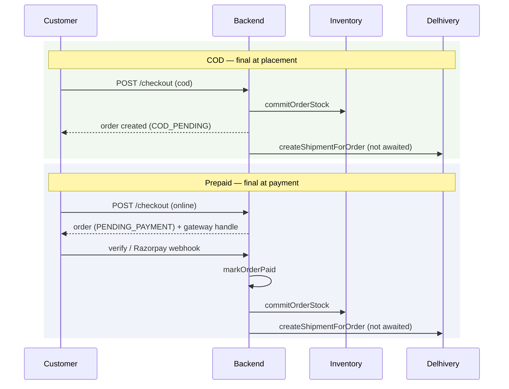

# Checkout to payment

## COD vs prepaid

The two differ in *when* the sale becomes final, and therefore in when stock is
taken and when shipping is booked.



**Why the difference:** an online order that is never paid must not hold
inventory hostage, so its stock is committed at payment, not at placement. A COD
order has no payment step to wait for.

## Stock

`commitOrderStock(orderId)` takes an order's items out of inventory **exactly
once**.

The guard is the `orders.stock_committed` flag, flipped by a conditional UPDATE
*inside the same lock* that performs the deduction:

```sql
UPDATE orders SET stock_committed = true
 WHERE id = $1 AND stock_committed = false
RETURNING id, user_id
```

If that updates no rows, somebody else already did it. A retried payment webhook
therefore cannot deduct twice.

`restoreOrderStock(orderId)` is the mirror, guarded by `stock_restored`, and it
takes units from the right counter: an undelivered order still holds them as
*reserved*, a delivered one has them as *sold*. Taking from the wrong counter
would either invent stock or lose it, so the two cases are separate calls rather
than one that guesses.

### Two inventory systems

Stock lives in two places during the SQL migration:

| Store | Controlled by |
|---|---|
| Legacy `cms_state` JSONB document | always written while `INVENTORY_MIRROR_LEGACY=true` |
| SQL `inventory` tables | written when `INVENTORY_SQL_MODE=true` **or** mirroring is on |

`inventoryWriteTargets()` decides. The important subtlety: SQL is written
whenever *either* flag is on — not only when SQL is authoritative. Writing only
when authoritative was a real bug: with `INVENTORY_SQL_MODE=false` the SQL side
received nothing and drifted on every order.

Only SQL's availability may refuse a sale when SQL is the system deciding. While
merely mirroring, a SQL failure is logged and surfaced by `inventory:verify`
rather than failing a customer's checkout over a secondary store.

### Reserved becomes sold on delivery

`applyShippingStatus` converts reservations to sold stock at `DELIVERED` — the
only moment the goods have demonstrably reached the customer. It is idempotent:
a redelivered webhook finds no `ACTIVE` reservations left.

The legacy document needs no counterpart. It has no concept of reserved or sold,
only a remaining-stock number, already decremented at commit.

## Serialisation

`withStockLock` wraps the critical section in two layers:

1. **An in-process promise chain** — stock lives in a cached JSONB document
   shared across every request in the process. Two concurrent checkouts reading
   the same cached array and both writing back would lose one decrement
   regardless of what the database does.
2. **A Postgres session advisory lock** — the chain only orders work *within one
   process*. `ecosystem.config.cjs` pins the app to a single pm2 fork precisely
   because of that; the advisory lock removes the silent dependency on that
   setting. Without it, the first person to add `instances: 2` reintroduces
   overselling with no error to warn them.

## Payment outcomes

| Function | Effect |
|---|---|
| `markOrderPaid` | the only path that may set `PAID`; commits stock, moves `PENDING_PAYMENT → CONFIRMED`, fires booking |
| `markOrderPaymentFailed` | records `FAILED`/`CANCELLED`/`EXPIRED`; cancels the order if it was still `PENDING_PAYMENT`. Leaves stock alone — an online order never committed any |
| `recordRefund` | partial and full distinguished by comparing against what was actually collected |
| `refundOrderPayment` | refunds only ever go back to the original instrument; COD returns early rather than pretending to issue one |

## What the customer gets back

Checkout responds with the order, an optional WhatsApp handoff URL, and the
gateway payment handle for prepaid. The shipment booking is **not** part of that
response — it is still running. The customer sees tracking appear a few seconds
later.
