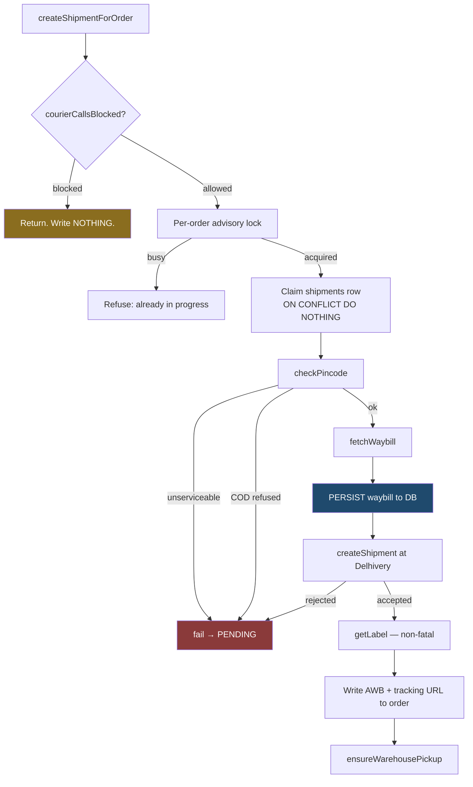

# Shipping — the Delhivery booking

Delhivery One (B2C) is a carrier operating its own network, not an aggregator.
That shapes the whole adapter:

- **No rate shopping.** There is no list of carriers and nothing to choose.
- **Waybills are drawn from a pool BEFORE the shipment exists.**
- **Pickups are booked per warehouse per day**, not per parcel.
- **No manifest and no invoice endpoint** exist at all.

The provider contract (`couriers/shippingProvider.ts`) is therefore expressed as
*capabilities a provider has or does not*, and callers ask rather than assume.

## The booking sequence



### Why persist the waybill before creating

This is the one ordering decision that matters for safety.

A waybill is drawn from the client pool *before* the shipment exists. If
`create.json` times out after Delhivery accepted it, the parcel exists and the
waybill is spent. A retry that drew a *fresh* waybill would create a second
parcel for the same order and leak the first.

Persisting first means the retry reuses the stored waybill and collides with the
unique index instead. The sequence is:

```
claim the shipments row → draw a waybill → PERSIST it → create
```

### Duplicate protection — three layers

| Layer | Stops |
|---|---|
| Per-order advisory lock (`withOrderShipmentLock`) | two concurrent callers both booking |
| Unique index on `shipments.order_id` | two shipment rows for one order |
| Partial unique index on `shipments.waybill` | one waybill on two shipments |

The lock is not redundant. The unique index only decides *who INSERTs the row*;
the caller that loses used to read that same row and carry on — two callers
holding one `shipmentRowId`, each drawing a waybill, the second overwriting the
first with an UPDATE no index can catch. One row, two parcels. The lock is what
makes the sequence single-threaded per order.

When the lock is busy, the second caller is **refused**, not queued. Queueing
behind the first would book the parcel a second time.

## What Delhivery receives

Built in `delhivery.service.ts` from the order, not from any provider shape:

| Delhivery field | Source |
|---|---|
| `name` | `orders.customer_name` (falls back to the address name) |
| `phone` | `orders.customer_phone` (falls back to the address phone) |
| `order` | `orders.order_number` — so their records and ours line up |
| `add` | address line 1 + line 2 / area / landmark, joined |
| `pin`, `city`, `state`, `country` | shipping address; country defaults to India |
| `payment_mode` | `COD` or `Prepaid` |
| `cod_amount` | **COD only** — order total. A COD shipment without one is a parcel delivered for free |
| `total_amount` | order total |
| `products_desc` | item names × quantities, capped at 250 chars |
| `quantity` | summed units |
| `weight` | grams — per-product weight where recorded, else `DELHIVERY_DEFAULT_WEIGHT_KG` |
| `shipment_length/width/height` | the configured defaults |
| `waybill` | the pre-drawn, already-persisted number |
| `seller_name`, `seller_add`, `seller_inv` | config + order number |

Getting the weight wrong means the courier re-weighs the parcel and bills the
difference back at a penalty rate, which is why per-product weights are used
where they exist.

`create.json` is the one endpoint that takes **form-encoded**
`format=json&data=<json>` rather than a JSON body.

### Verified against a real order

`GLM87268832` → Delhivery echoed back:

```json
{ "refnum": "GLM87268832", "waybill": "66366010000475", "payment": "COD",
  "cod_amount": 448, "status": "Success", "serviceable": true,
  "sort_code": "JAI/SEZ", "client": "GLAMIRK B2C" }
```

`refnum` = our order number, `cod_amount` = our total, `sort_code` = Jaipur,
matching the 302017 delivery pincode.

## Serviceability — two checks, not one

```ts
if (!serviceability.value?.serviceable) fail(...)
if (isCod && serviceability.value.codAvailable === false) fail(...)
```

A pincode can be serviceable for prepaid and still refuse cash. Delhivery reports
the two separately. Booking a COD parcel into a prepaid-only area gets it refused
at the door and returned as an RTO — caught here instead, while it is still a
message to an operator rather than a parcel on a van.

The COD check is strictly `=== false`: `undefined` means the provider did not
say, and a missing answer must not block a sale.

Embargo is distinguished from a plain refusal — one clears on its own, the other
needs the address changed.

## Waybill allocation is never retried

`fetchWaybill` uses `attempts: 1`.

The pool hands out a **new** number per call, so an automatic retry after a
timeout draws a second waybill and permanently strands the first — a number the
client paid for that no parcel will ever carry. The HTTP layer cannot tell "the
request never arrived" from "it was answered and we hung up first", so it is not
allowed to guess on this endpoint.

An ambiguous outcome (timeout, network drop, 5xx) is flagged `ambiguous` on the
result and reported in its own words, so a leaked waybill is visible in
`last_error` rather than discovered on an invoice. A 4xx is the one honest
"nothing happened".

Read-only lookups (serviceability, tracking, label) keep `attempts: 2` — the
single-attempt rule is targeted at allocation, not blanket.

## Pickup

Warehouse-level: one request covers every parcel waiting at that location that
day. Calling it per shipment would book a van per order, which is why
`ensureWarehousePickup()` takes no shipment and is safe to call after every
creation.

The duplicate guard is the partial unique index on
`(provider, pickup_location, pickup_date) WHERE status = 'OPEN'`, claimed
*before* the provider is called. A second caller loses the insert and returns
without touching Delhivery, incrementing the declared package count instead.

A failed booking is marked `FAILED`, never left `OPEN` — an open row would block
every retry for the rest of the day behind a booking that does not exist.

## Label

Fetched automatically at the end of a successful booking, and **non-fatal**: the
parcel is real and trackable without one, and it can be regenerated from the
admin panel at any time. `ensureShipmentLabel` is idempotent by stored URL.

## Shipment edits

`editShipment` takes an **allowlist** of documented fields, not a caller-supplied
object spread. `cancellation` is deliberately absent — `cancelShipment` owns that
flag, builds its own body, and checks the refusal case. Routing it through a
generic edit would bypass both.
