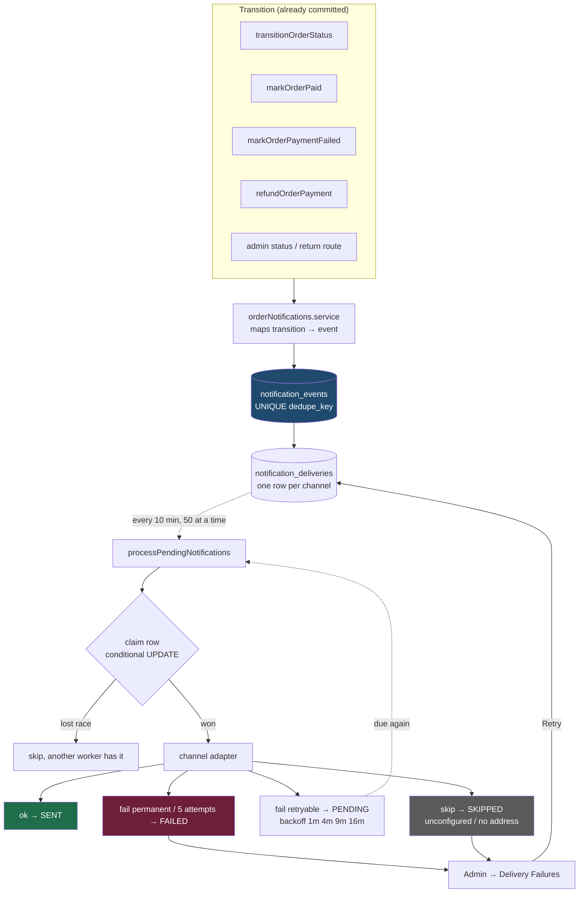

# Notifications — one engine, one outbox

How a Glamirk order transition becomes a message in a customer's inbox or on
the store's notification bell, and what the system guarantees along the way.

Written against the working tree after the engine migration. Every file:line
reference below was read from the code, not remembered.

---

## 1. Why this exists

Before the engine, every place that moved an order called `notifyX(...)` and
`sendOrderStatusEmail(...)` side by side. There were **nineteen such pairs**
across `fulfillment.service`, `admin.routes` and `customer.routes`.

Each pair had to independently remember the same four things:

- don't fire twice
- don't fire before the write commits
- don't let a provider failure undo the transition
- pass the customer's email, which is a fact about the order, not the caller

Several forgot. Payment failure and refunds told the customer **nothing at
all**, and a prepaid order reached the store's bell only by accident. Adding a
channel meant editing all nineteen; missing one meant it went quiet with no
error anywhere.

All nineteen are gone. What replaced them is one mapping layer, one outbox,
and one worker.

---

## 2. The whole flow on one page



**Nothing is sent inline.** A transition writes outbox rows and returns, so a
slow SMTP round-trip can never sit inside a payment confirmation, and a
provider outage can never roll back a payment.

---

## 3. The three layers

| Layer | File | Knows about |
|---|---|---|
| Mapping | `services/orderNotifications.service.ts` | orders, returns, refunds → event types |
| Engine | `services/notificationEngine.service.ts` | outbox, dedupe, retries, backoff |
| Channels | `services/notificationChannels.service.ts` | copy, providers, recipients |

The engine has no idea which providers exist — channels **register
themselves** (`registerChannel`, `notificationEngine.service.ts:216`). The
mapping layer is the only place that holds an opinion about which transition
deserves which message, so `fulfillment` can say *"this order shipped"*
without knowing anything about email.

---

## 4. Which transition fires what

Every entry point, as wired today:

| Transition | Call site | Event(s) |
|---|---|---|
| Any order status move | `fulfillment.service.ts:269` | `ORDER_*` per the status map |
| …reaching DELIVERED | `fulfillment.service.ts:280` | `+ ADMIN_ORDER_DELIVERED` |
| Payment confirmed | `fulfillment.service.ts:357` | `ADMIN_ORDER_PAID` (+ `ORDER_CONFIRMED` via the status move) |
| Payment failed / cancelled / expired | `fulfillment.service.ts:426` | `PAYMENT_FAILED` |
| Refund processed | `fulfillment.service.ts:1314, 1465, 1598` | `REFUND_COMPLETED` + `ADMIN_REFUND_ISSUED` |
| Admin changes status | `admin.routes.ts:613` | `ORDER_*` |
| Admin changes return status | `admin.routes.ts:1256` | `RETURN_*` |
| Checkout (COD) | `customer.routes.ts:1878` | `ORDER_PLACED` |
| Checkout (both methods) | `customer.routes.ts:1846` | `ADMIN_NEW_ORDER` |
| Customer cancels | `customer.routes.ts:2320` | `ORDER_CANCELLED` |

### Status → event

`orderNotifications.service.ts:54`. Preserved exactly from the two legacy maps
it replaces, **plus** `PROCESSING`, which both old maps skipped:

```
PLACED → ORDER_PLACED          PACKED           → ORDER_PACKED
CONFIRMED → ORDER_CONFIRMED    SHIPPED          → ORDER_SHIPPED
PROCESSING → ORDER_PROCESSING  OUT_FOR_DELIVERY → ORDER_OUT_FOR_DELIVERY
CANCELLED → ORDER_CANCELLED    DELIVERED        → ORDER_DELIVERED
```

Silent on purpose, as before: `PENDING_PAYMENT` (an unpaid order is a request,
not an order), `READY_TO_SHIP` (warehouse bookkeeping), and
`RETURN_REQUESTED` / `RETURNED` / `RTO`, which the return workflow narrates
instead.

### Channel routing

`notificationEngine.service.ts:122`. In-app is on every customer event — it is
the one channel that actually works today, and it costs nothing.

| Event group | Channels |
|---|---|
| Order placed / confirmed / shipped / out-for-delivery / delivered | `inapp`, `email`, `whatsapp` |
| Processing, packed, cancelled, payment failed | `inapp`, `email` |
| Returns (5 states) | `inapp`, `email` |
| Refund completed | `inapp`, `email`, `whatsapp` |
| `ADMIN_NEW_ORDER` | `admin_inapp`, `admin_whatsapp` |
| `ADMIN_ORDER_PAID` / `_DELIVERED` / `_REFUND_ISSUED` | `admin_inapp` |

Store-facing events are **separate event types**, not extra channels on the
customer events. A bug in recipient resolution therefore cannot send a
customer an internal message, or the store a customer's — the two sets share
no channel and no copy.

---

## 5. Exactly once

The guarantee is a `UNIQUE` index on `notification_events.dedupe_key`
(migration `018`), and the key is composed from **the transition**, never from
the clock.

| Event | Key | Why |
|---|---|---|
| Order status | `{orderId}:{eventType}` | A repeated admin click, a redelivered courier webhook and the reconciliation sweep all produce the same key |
| Payment failure | `{orderId}:PAYMENT_FAILED` | Not keyed on the failure *kind* — a decline followed by the expiry sweep must not send two |
| Refund | `{orderId}:REFUND_COMPLETED:{refundRef}` | Keyed per **refund row**, because partial refunds are real: three refunds are three things the customer must hear about |
| Return | `{returnId}:{eventType}` | Keyed on the return, not the order — one order can have several |

This is a second line of defence, not the first. Each caller already filters
replays with a conditional `UPDATE … WHERE status = $expected RETURNING`, so
a losing caller returns before it ever reaches the enqueue. The dedupe key is
what holds when two *different* code paths both legitimately arrive at the
same transition — which, for payment confirmation, is the normal case:
browser verify, Razorpay webhook and the reconciliation sweep all call
`markOrderPaid` for the same payment.

### Why the payload is frozen

`notification_events.payload` is a JSONB snapshot captured when the event
occurred. Rendering happens later — possibly minutes later, after a retry.
Re-reading the order at that point could pick up a status that has since moved
on and send a customer a message describing a state their order is no longer
in.

---

## 6. Delivery, retries, backoff

`processPendingNotifications` (`notificationEngine.service.ts:227`), run on
`SWEEP_INTERVAL_MS` in `server.ts` — **every 10 minutes** — bounded to 50 rows
a pass so a backlog is worked through steadily rather than in one burst that
stalls the event loop.

> **Why ten minutes, when the work is cheap and an email ought to go out fast?**
>
> Because the interval is a property of the hosting, not of this job. A
> serverless Postgres suspends its compute only after a fixed idle window —
> five minutes on Neon — and a loop that queries more often than that means the
> window never elapses, so the compute bills around the clock.
>
> This loop ran every **60 seconds** until 2026-10-26. The compute never slept,
> the account exhausted its allowance, and Neon refused every connection with
> `SQLSTATE 53000` for three days. The running process survived on its
> established pool, so the site kept returning 200 while every database-backed
> feature failed — which is why nobody noticed until a restart forced the
> boot-time schema check against a database that would no longer answer.
>
> Ten and not five: five exactly *equals* the idle window, so a sweep lands
> just as it is about to be reached and resets it. The interval has to clear
> the window, not merely match it. The reconciliation sweep shares the same
> constant for the same reason — setting the two independently is what let a
> 60-second loop quietly undo a 5-minute one.
>
> The consequence is real and accepted: a notification can now sit for up to
> ten minutes before its first attempt.

Up to **six deliveries are attempted concurrently** (`DELIVERY_CONCURRENCY`).
Not fifty: these are outbound provider calls, and the point is to stop one
slow send blocking the queue, not to flood the provider.

Each delivery is claimed by taking a **lease** before it is attempted:

```sql
UPDATE notification_deliveries
   SET attempts = attempts + 1, total_attempts = total_attempts + 1,
       last_attempt_at = now(),
       next_attempt_at = now() + interval '5 minutes'   -- the lease
 WHERE id = $1
   AND status = 'PENDING'
   AND (next_attempt_at IS NULL OR next_attempt_at <= now())
RETURNING attempts
```

If that updates nothing, another worker holds the lease. No lock, no double
send.

The `next_attempt_at` condition is the whole guard. An earlier version
matched only on `status = 'PENDING'` — but the row *stays* PENDING for the
duration of the attempt, so a second worker's identical UPDATE matched too
and the message went out twice. Reusing the due-ness column as a lease fixes
that without adding a transient `SENDING` status, which would leak internal
state into the admin panel and strand rows forever if the process died
mid-send. A lease just expires: a delivery abandoned by a crashed worker
becomes due again on its own.

### The four outcomes

| Channel returns | Row becomes | Meaning |
|---|---|---|
| `{ ok: true }` | `SENT` | The provider accepted it |
| `{ skip: true }` | `SKIPPED` | Deliberately not sent — unconfigured, no address. Terminal, but **not a failure** |
| `{ retryable: true }` | `PENDING` | Try again after backoff |
| `{ retryable: false }` or attempt 5 | `FAILED` | Given up on |

A channel that *throws* is treated as retryable — that's a bug in the adapter,
not a provider refusal, and a transient crash should not permanently drop a
message.

**Backoff** is `min(60 × n², 3600)` seconds — ~1m, 4m, 9m, 16m, 25m. Squared
rather than doubled so the early retries, which catch most transient failures,
stay close together without the tail running away.

Those are the times a row becomes *due*, not when it is *tried*: a retry cannot
fire before the next sweep, so with a 10-minute interval the early steps are
effectively rounded up to it and the schedule reads more like 10m, 10m, 10m,
20m, 30m. The squaring still matters for the tail; it no longer buys anything
at the front. Worth knowing before concluding a retry "didn't happen" — check
`next_attempt_at` against the sweep clock, not against the wall clock.

**SKIPPED is never SENT.** This matters most for WhatsApp: a message not sent
because no provider is configured is not a delivery, and the row says so.

---

## 7. When it breaks: the admin panel

**Admin → Overview → Delivery Failures** (`AdminNotificationDeliveries.tsx`).

Before this screen, a failed notification was a `console.error` on a server
nobody reads, so *"the customer says they never got the shipping email"* had
no answer.

| | |
|---|---|
| `GET /api/admin/notifications/deliveries` | status / channel filters, search by order number or event type, pagination |
| `POST /api/admin/notifications/deliveries/:id/retry` | re-queues one terminal delivery |

Both `requireAdmin`. Retries are written to the CMS audit log as
`RETRY_NOTIFICATION` with the acting admin, and to `requeued_by` on the row
itself — the audit log is a 300-entry ring buffer, so a recurring failure may
outlive its entry there.

**PENDING is listed next to FAILED.** A delivery at *"attempt 4 of 5, next try
in 16 minutes"* is the one most worth seeing, and it is not FAILED yet; a
screen showing only terminal failures would go quiet exactly while something
was going wrong.

### What Retry does and does not do

- Resets `attempts` to 0 — the reason an operator presses it is that they just
  fixed the cause (bad SMTP password, newly approved template), which the
  previous attempts could not have known.
- Does **not** reset `total_attempts` (migration `019`), so the row still reads
  *"attempt 1 of 5, 12 overall"*.
- Refuses when the channel is structurally blocked, naming the exact missing
  piece, rather than spending an attempt to rediscover it.
- Two admins pressing Retry at once: the `WHERE status IN ('FAILED','SKIPPED')`
  clause is itself the guard. One wins, the other is told it is already queued.

**There is no route that sets a status.** Only a provider accepting a message
may mark it `SENT`; an admin override would turn the one honest record of what
reached a customer into a wish.

### Privacy

Recipients are masked — `ri•••••@gmail.com`, `+91••••••10`. An operator needs
to tell one customer's address from another's; they do not need the address.
Admin-channel rows carry no customer contact at all. The raw event payload,
the delivery address and payment details never reach this screen.

---

## 8. Provider status

| Channel | State |
|---|---|
| `inapp` / `admin_inapp` | **Working.** Writes the notification row and pushes over Socket.IO |
| `email` | **Wired, failing.** SMTP rejects with `535-5.7.8` — needs a Gmail App Password |
| `whatsapp` / `admin_whatsapp` | **Wired, inert.** No `WHATSAPP_PROVIDER`, no credentials, no approved template |

The WhatsApp adapters are deliberately real code that records a `SKIPPED` row
naming exactly what is missing, rather than absent code or a pretend send.
They will start sending the day credentials and Meta-approved utility
templates exist, and not before — the OTP template cannot be reused for order
updates.

> **No WhatsApp message has ever been delivered by this system.** Do not treat
> the channel as operational until a controlled end-to-end send is verified.

---

## 9. Known gaps

| Gap | Impact |
|---|---|
| SMTP unconfigured | Every customer email fails. Now *visible* per-message on the Delivery Failures screen rather than silent. |
| WhatsApp has no provider or template | All WhatsApp deliveries `SKIPPED`. |
| No bulk retry | Row-level only. Deliberate while the common cause is a single misconfiguration. |
| `sendAdminNewOrderEmail` not on the engine | Retained intentionally — a plain email to the store's own `contactEmail`, a different recipient and purpose from `ADMIN_NEW_ORDER`. Folding it in needs an admin-email channel. |
| Admin store-facing events are in-app only | Adding WhatsApp would multiply store alerts the day a provider connects — a decision to make deliberately, not inherit from the migration. |

---

## 10. Reading the code

Start at the mapping layer; it is the shortest file and it names every
transition that produces a message.

```
services/orderNotifications.service.ts   transition → event      (the map)
services/notificationEngine.service.ts   outbox, dedupe, retry   (the mechanism)
services/notificationChannels.service.ts copy, providers         (the words)
database/migrations/018_notification_outbox.sql       the two tables
database/migrations/019_notification_delivery_history.sql  retry history
```

Regression coverage lives in `backend/src/test/checkout.e2e.ts` under three
sections: *Notification engine*, *Admin delivery-failures panel*, and *Engine
migration*.
