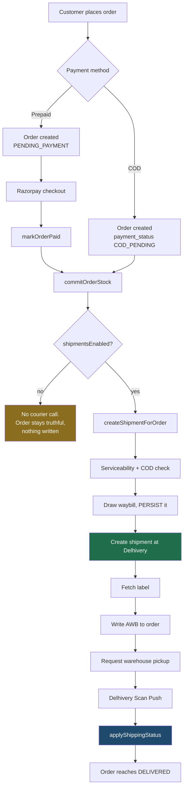

# Order flow — system design

How a Glamirk order travels from a customer's basket to a parcel in Delhivery's
network, and what the system guarantees at each step.

Written against the code as deployed on `main` (merge `ab7bfa4`), and verified
end to end against one real production order — `GLM87268832`, AWB
`66366010000475` — not from the source alone.

## Read in this order

| File | Answers |
|---|---|
| [01-lifecycles.md](01-lifecycles.md) | Three status columns, not one. Which is authoritative for what. |
| [02-entry-points.md](02-entry-points.md) | Every path that can move an order, and which are live today. |
| [03-checkout-to-payment.md](03-checkout-to-payment.md) | Basket → order → stock → paid. COD vs prepaid. |
| [04-shipping-delhivery.md](04-shipping-delhivery.md) | The booking sequence and why it is ordered the way it is. |
| [05-tracking-webhooks.md](05-tracking-webhooks.md) | Scan Push, polling, status mapping. |
| [06-failure-and-safety.md](06-failure-and-safety.md) | What breaks, what the system promises anyway. |
| [07-configuration.md](07-configuration.md) | Every flag, what it switches, and the runbook. |
| [10-notifications.md](10-notifications.md) | How a transition becomes a message. Outbox, dedupe, retries, the failures panel. |

## The whole flow on one page



Everything from "Customer places order" to "Request warehouse pickup" is
**automatic**. On the verified order it took 5.6 seconds end to end, with no
human in the loop:

```
order created      19:21:08.970
shipment row       19:21:12.553   +3.58s
waybill drawn      19:21:13.456   +4.49s
pickup requested   19:21:14.566   +5.60s
```

## The four promises

1. **A real customer order never gets fake tracking.** In production the mock
   courier cannot be reached — see [06](06-failure-and-safety.md#the-safety-gate).
2. **One order, one parcel.** Duplicate booking is prevented by an advisory lock
   plus two unique indexes, not by hoping.
3. **A failed courier call never damages the order.** The sale survives; the
   shipment records why it is waiting.
4. **An unknown courier status changes nothing.** Statuses are mapped from a
   fixed table; anything unrecognised is recorded and ignored.

## Known gaps

Current as of the Delhivery go-live. Each is covered in detail in
[06](06-failure-and-safety.md) and [07](07-configuration.md).

| Gap | Impact |
|---|---|
| No retry sweep for booking / pickup / label | A failed step waits for an admin click. Nothing retries it. |
| SMTP is unconfigured in production | No customer email is delivered. Since the notification engine landed, each failure is a queryable row with the provider's error, visible under Admin → Delivery Failures — see [10](10-notifications.md#8-provider-status). |
| WhatsApp has no provider or approved template | Every WhatsApp delivery records `SKIPPED`. Nothing has ever been sent. |
| Scan Push not yet enabled by Delhivery | No automatic tracking updates; admin must poll. |
| Razorpay unconfigured in production | Only COD orders are possible. |
| No OTP channel configured | Customers cannot sign in with a mobile number. |
