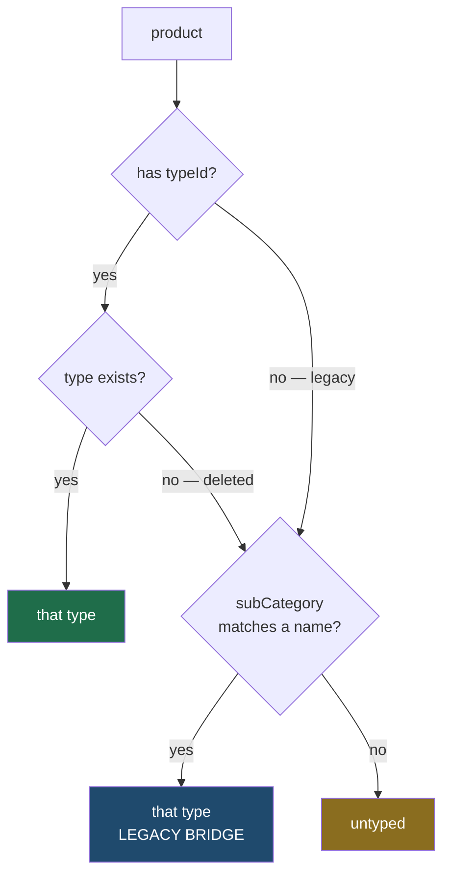

# 01 — Data model

## Where the rows live

Types are a **normalized table**; the catalog is not.

| Thing | Storage | Why |
|---|---|---|
| Product types | `product_types` table (migration 021) | Case-insensitive uniqueness must be enforced where two admins cannot both win. That is a unique index. |
| Products | `cms_state.data->'products'` (JSONB) | Unchanged by this work. Moving the catalog out is a separate project touching checkout, inventory and orders. |

```sql
CREATE TABLE product_types (
  id          TEXT PRIMARY KEY,          -- 'ptype-<slug>', immutable
  name        TEXT NOT NULL,             -- display label, freely renameable
  slug        TEXT NOT NULL,             -- URL identity, never regenerated
  description TEXT NOT NULL DEFAULT '',
  category    TEXT,                      -- 'Makeup' | 'Skin' | 'Nails' | NULL
  is_active   BOOLEAN NOT NULL DEFAULT TRUE,
  sort_order  INTEGER NOT NULL DEFAULT 0,
  created_at  TIMESTAMPTZ NOT NULL DEFAULT NOW(),
  updated_at  TIMESTAMPTZ NOT NULL DEFAULT NOW()
);
```

`category` is nullable on purpose: a type with no section still lists and still
filters, it simply does not nest under one.

## Three identities, three jobs

This is the distinction the whole design rests on.

| Field | Mutable? | Used for |
|---|---|---|
| `id` | **Never** | What products reference. Survives every rename. |
| `slug` | **Never** (not regenerated on rename) | URL identity — `?type=lip-care`. Regenerating it would break every published link the moment someone fixed a typo. |
| `name` | Freely | Display only. The filter row, the pill, the admin list. |

`updateProductType` deliberately does **not** recompute the slug when the name
changes. Id and slug are the stable pair; the name is the label.

## Uniqueness

```sql
CREATE UNIQUE INDEX product_types_name_lower_idx ON product_types (LOWER(name));
```

"Lip Care" and "lip care" are the same type to a human, so they must be the
same row to the database. This is a **functional unique index**, not a `CHECK`
and not an application guard, because only the database can decide a
whole-table property at one instant under concurrency.

The service checks for a duplicate *before* inserting — but only to produce a
readable message. The insert still catches `23505` and returns the same 409,
because the pre-check loses the race and the index does not. Both paths are
covered by tests; `producttypes.db.e2e.ts` also inserts a case-variant with raw
SQL to prove the index rejects it with no application code involved.

## Resolution order

`resolveProductType()` in `shared/src/utils/productType.ts` is the single
answer to "what type is this product?", read by the server, the admin and the
storefront alike.



1. **`product.typeId`** — set by the admin form. Survives renaming.
2. **`product.subCategory`** matched against type **names**, case- and
   whitespace-normalised. This is the legacy bridge: every product saved before
   types existed resolves through it, which is why no product had to be
   rewritten.
3. **Untyped.**

A `typeId` pointing at a deleted type deliberately **falls through to step 2**
rather than resolving to nothing, so removing a type out from under a product
degrades to legacy behaviour instead of hiding it from the catalog.

## Why `subCategory` is kept in step

When a type is assigned, the server writes **both** fields:

```ts
{ ...payload, typeId: resolved.type.id, subCategory: resolved.type.name }
```

`typeId` is the stable reference; `subCategory` carries the current name so
every consumer that predates types — the homepage category grid, published
`?subCategory=` links, the legacy filter path — keeps describing the product
the same way. The two are also re-synced on rename and on reassign.

## Slug derivation must match the migration

`slugifyTypeName()` lowercases, replaces runs of non-alphanumerics with a
single hyphen, and trims hyphens from both ends. Migration 021's backfill uses
the equivalent SQL:

```sql
TRIM(BOTH '-' FROM REGEXP_REPLACE(LOWER(TRIM(...)), '[^a-z0-9]+', '-', 'g'))
```

These two **must** agree. A backfilled row and an admin-created row that
produce different slugs for the same name would collide on the id, turning an
ordinary create into a confusing constraint error. `producttypes.e2e.ts` pins
the JS side (`'Lip   &   Cheek'` → `lip-cheek`, `'  !Lipstick!  '` →
`lipstick`, `'!!!'` → `''`), and a name that slugifies to nothing is rejected
with a reason rather than saved as something unreachable.

## Counting

`countProductsByType()` makes **one pass** over the catalog building a `Map`,
rather than a `filter()` per type. With T types and P products the obvious
version is O(T·P); this is O(P). At current catalog size either works — the
reason to prefer this one is that the counts re-render on every Shop keystroke,
and it never needs revisiting as the catalog grows.
