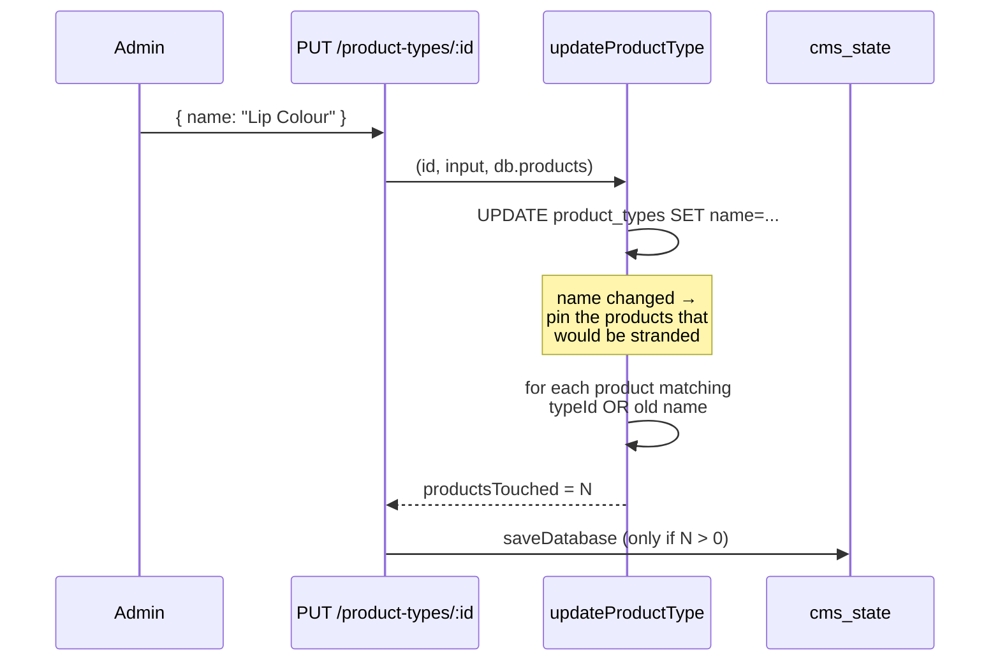

# 02 — Admin flow

## Where the two surfaces live

| Surface | File | Purpose |
|---|---|---|
| Type picker | `admin/src/components/admin/ProductTypePicker.tsx` | Inside the product form. Search, select, **create inline**. |
| Type manager | `admin/src/components/admin/ProductTypeManager.tsx` | Inside **Categories & Taxonomy**. Rename, pause, reassign, delete, with usage counts. |

The manager is mounted on the existing Categories & Taxonomy screen rather than
as a new nav entry: "what kinds of product do we sell" is the same question
that screen already answers, and a separate screen would be a second taxonomy
to hold in your head. It renders **above** the category cards because it is the
list that actually drives Shop's filter — the cards below are the homepage's
presentation grid.

## Creating from inside the product form

Creating a type without leaving a half-filled product is the point. The
alternative — leave, go to another screen, create it, come back — is how people
end up typing a near-duplicate (`"Lip care"`, `"Lip Care "`) instead.

The create row is pre-filled with whatever was typed in the search box, and a
name that already exists is surfaced **before** the request:

> That type already exists — select it from the list above.

So the usual outcome is picking the existing type, not being told off for
typing it.

## Endpoints

| Method | Path | Notes |
|---|---|---|
| `GET` | `/api/admin/product-types` | All types **with usage counts**. |
| `POST` | `/api/admin/product-types` | 409 on duplicate name. |
| `PUT` | `/api/admin/product-types/:id` | Rename / describe / section / activate. |
| `POST` | `/api/admin/product-types/:id/reassign` | `{ targetTypeId, deleteAfter }`. |
| `DELETE` | `/api/admin/product-types/:id` | **Refused** while products reference it. |

All behind `requireAdmin`. Every mutation writes an audit log entry
(`CREATE_PRODUCT_TYPE`, `UPDATE_PRODUCT_TYPE`, `REASSIGN_PRODUCT_TYPE`,
`DELETE_PRODUCT_TYPE`) and broadcasts `CMS_UPDATE` so connected storefronts
pick the change up without a reload.

Reads carry usage counts because **every destructive choice here depends on how
many products are affected**, and an admin should never have to guess that.

## Rename — the interesting one

A product referencing the type **by id** is safe by construction. A **legacy**
product has no `typeId` and is matched by comparing its `subCategory` to the
type's name — so the instant the name changes it stops resolving and vanishes
from the filter. That is the original bug, reintroduced by a different route.

So on rename, products matching either by id *or* by the **old** name are
pinned to the id and their `subCategory` is brought up to the new name. This is
the last moment that inference is available: afterwards nothing records that
those products meant this type.

This lives in `updateProductType` (the service), **not** in the route. It is an
invariant of renaming, not of one HTTP handler — a second caller that forgot it
would silently reintroduce the orphaning. A test that called the service
directly is what caught it sitting in the wrong layer.

## Pause vs delete

|  | Pause | Delete |
|---|---|---|
| Products keep resolving | **Yes** | — |
| Hidden from Shop | Yes | Yes |
| Allowed while in use | **Yes** | **No — 409** |
| Reversible | Yes, one click | No |

Deactivating is the safe retirement. An inactive type is still returned by
`listProductTypes()` and still resolves for its products; only
`selectableTypes()` withholds it from the shopper.

Deletion is the only operation that can orphan, so it is the only one blocked
outright:

> "Lip Care" is still assigned to 1 product. Reassign them to another type
> first, or deactivate this type instead — deactivating hides it from Shop
> while keeping those products working.

There is deliberately **no force flag**. No version of "delete this and leave N
products pointing at nothing" is the right outcome. When the refusal lands, the
manager opens the reassign row automatically so the next step is in front of
the admin rather than buried in the message.

## Reassign

Moves every product off one type onto another, matching by id *or* legacy name,
then optionally deletes the source. Two buttons — **Move** and **Move &
Delete** — because the safe path and the destructive one should not be the same
click.

If the follow-up delete is refused, the move that *did* happen is still
reported rather than failing the whole request.

## Validation

Enforced server-side in `productType.service.ts`, so the rules cannot be
bypassed by a direct API call:

| Rule | Response |
|---|---|
| Empty / whitespace-only name | 400 |
| Name > 60 chars | 400 |
| Name with no alphanumerics (`"!!!"`) | 400 — it has no addressable slug |
| Description > 500 chars | 400 |
| Section not in Makeup/Skin/Nails | 400 |
| Duplicate name (any case) | 409 |
| Unknown `typeId` on product save | 400 — never saved pointing at nothing |

## Caching

`listProductTypes()` keeps a module-level cache, mirroring the `cachedDb` idiom
in `db.ts` rather than inventing a second caching style. Every mutation in the
service calls `invalidateProductTypeCache()`.

Scope is the process, like `cachedDb`. A second instance keeps its own copy
until its own next mutation — the same consistency the CMS document already
has, and acceptable for a list that changes a few times a month.
