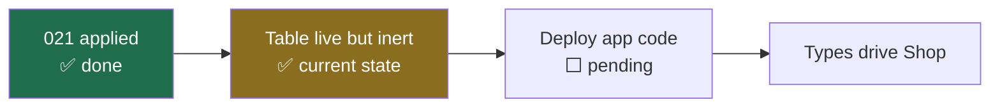

# 04 — Migration and rollout

## Migration 021

`database/migrations/021_product_types.sql` — **five statements, all additive**:

| Verb | Count | Target |
|---|---|---|
| `CREATE TABLE IF NOT EXISTS` | 1 | `product_types` (new) |
| `CREATE [UNIQUE] INDEX IF NOT EXISTS` | 3 | `product_types` only |
| `INSERT … ON CONFLICT DO NOTHING` | 1 | `product_types` only |

No `UPDATE`, `DELETE`, `DROP`, `ALTER` or `TRUNCATE`. `cms_state` appears
exactly once — in the `FROM` clause of the backfill's SELECT. It is **read,
never written**.

## The runner

`backend/src/db/migrate.ts` wraps each file in a transaction:

```
BEGIN → file SQL → INSERT schema_migrations row → COMMIT
```

with `ROLLBACK` on any error. So 021 was atomic: all five statements landed or
none did. Pending files are selected by `version NOT IN schema_migrations`, so
an applied migration is never re-executed.

Editing an applied migration produces a **warning, not a silent skip** — the
checksum is recorded at apply time and compared on every run.

## The backfill

Every distinct `subCategory` already in the catalog becomes a type, so legacy
products map onto one from the moment this applies and none is left untyped.

Done in SQL rather than application code so that a database which has run the
migration is never half-populated, regardless of whether the app has started.

```sql
SELECT DISTINCT ON (LOWER(NULLIF(TRIM(p->>'subCategory'), '')))
  ...
ORDER BY LOWER(NULLIF(TRIM(...))), NULLIF(TRIM(...))
```

`DISTINCT ON (LOWER(TRIM(...)))` collapses values differing only by case or
surrounding whitespace, so the unique index cannot be violated by two spellings
of one type.

The tie-break is on the **trimmed** name, not the raw value. Between `"Lips"`
and `" lips "` the raw ordering puts the leading space first and the type would
be named `"lips"`; comparing trimmed values makes the capitalised spelling win,
which is the one a shopper sees on a filter row. *(This was caught by a test —
the first draft named it `"lips"`.)*

Ids derive from the slug (`'ptype-' || slug`) rather than being random, so
re-running on a database that already has these rows is a no-op, not a
duplicate.

## What it did to production

Applied **2026-10-14 05:58:43 UTC** to `neondb`, one migration, 20 already
present.

Backfilled from the 12 live products:

| id | name | section | products |
|---|---|---|---|
| `ptype-cleansing` | Cleansing | Skin | 1 |
| `ptype-eyes` | Eyes | Makeup | 1 |
| `ptype-face` | Face | Makeup | 1 |
| `ptype-lips` | Lips | Makeup | 9 |

**Nothing existing was modified.** The proof is not an argument from the SQL:

```
021 applied_at      : 2026-10-14T05:58:43Z
cms_state updated_at: 2026-10-12T06:38:26Z   ← ~2 days EARLIER
```

Had the migration touched the catalog, `updated_at` would have moved.

Post-migration audit: 12 products with prices (₹99–₹749), stock and shade
counts intact; **0 products carry a `typeId`**; **0 products fail to resolve**
to a type. Orders 56, order_items 58, inventory 20, inventory_transactions 67,
customers 52, cart_items 32, shipments 1, reviews 1, returns 2 — all untouched,
and all unreachable by this migration.

The `UNIQUE (LOWER(name))` index was confirmed live by attempting to insert
`"LIPS"` alongside the existing `"Lips"` — rejected with `23505`, probe row
cleaned up.

## Deploy order

The migration is **safe to run before the code ships**, which is what happened:



Deployed code does not know the table exists, so the live site is unchanged
until the deploy. The schema is forward-compatible in both directions: old code
ignores the table, new code requires it.

## Rollback

```sql
DROP TABLE product_types;
DELETE FROM schema_migrations WHERE version = '021_product_types.sql';
```

Returns production to its exact prior state, because nothing outside that table
changed. **PITR is not the recovery path** — no backup is needed to undo this.

Safe while the code is undeployed. After deploy, rolling back the schema
requires rolling back the code too.

## Test coverage

| Suite | Checks | Needs a DB? |
|---|---|---|
| `producttypes.e2e.ts` | 42 | No — slugs, validation, resolution, counts, the legacy catalog |
| `producttypes.db.e2e.ts` | 45 | Yes, a database with `test` in its name |

The DB suite covers what only Postgres can answer: the backfill (including two
spellings collapsing to one row), the unique index rejecting a case-variant via
raw SQL, re-applying being a no-op, rename-without-orphaning, pause, the delete
refusal with its count, and cache invalidation after every mutation.

Regression suites run alongside: variants 188, variantflow 86, checkout 716,
inventory 121, cmsstate 19 — all passing.

## Verifying a deployment

```bash
# types present?
GET /api/cms/content            → { productTypes: [...] }

# admin list with usage counts
GET /api/admin/product-types    → { types: [{ ..., productCount }] }

# migration ledger
SELECT version, applied_at FROM schema_migrations
 WHERE version = '021_product_types.sql';

# nothing orphaned
SELECT count(*) FROM cms_state, LATERAL jsonb_array_elements(data->'products') p
 WHERE NOT EXISTS (
   SELECT 1 FROM product_types t WHERE LOWER(t.name) = LOWER(TRIM(p->>'subCategory'))
 );   -- expect 0
```
