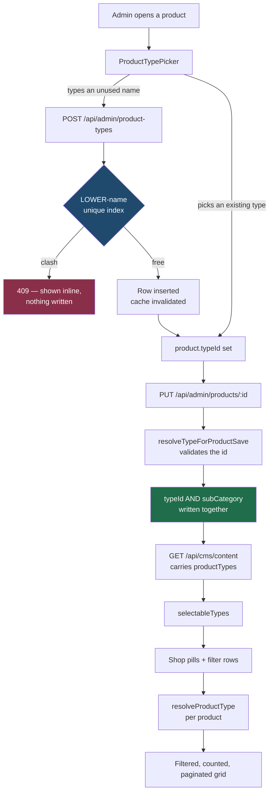

# Product types — system design

How an admin-defined product type ("Lipstick", "Sindoor", "Lip Care") is
created, assigned, renamed and retired, and how it reaches Shop's filters
without anyone editing a line of frontend code.

Written against the working tree as of 2026-10-14 (feature branch work on top
of `e9667fc`), and verified against a live run of the app plus the production
database — not from the source alone.

> **Deploy status.** Migration 021 is applied to production. The application
> code described here is **not deployed yet**. See
> [04-migration-and-rollout.md](04-migration-and-rollout.md).

## Read in this order

| File | Answers |
|---|---|
| [01-data-model.md](01-data-model.md) | Why types are keyed by id, how a legacy product still resolves, where the rows live. |
| [02-admin-flow.md](02-admin-flow.md) | Create, assign, rename, pause, reassign, delete — and what each one is allowed to break. |
| [03-shop-flow.md](03-shop-flow.md) | Pills, filter rows, counts, URLs and pagination. |
| [04-migration-and-rollout.md](04-migration-and-rollout.md) | What 021 did to production, deploy order, rollback. |

## The whole flow on one page

Nothing in that path requires a code change to add a type. The pills and the
filter rows are derived from the same list the admin edits.

## The five promises

1. **A rename never orphans a product.** Products reference a type by
   immutable id, so changing the label moves nothing. Legacy products matched
   only by name are pinned to the id at the moment of the rename — the last
   point at which that inference exists. See
   [01](01-data-model.md#resolution-order).
2. **A swatch a shopper can see is a product a shopper can buy.** Shop's filter
   and the server's own notion of a valid type read the same function, so the
   two cannot drift into disagreeing. See [03](03-shop-flow.md#one-rule-one-place).
3. **Two spellings of one name cannot both exist.** Uniqueness is a
   `UNIQUE (LOWER(name))` index, not an application check — the only layer that
   can win that race. See [01](01-data-model.md#uniqueness).
4. **Deactivating hides, it never orphans.** An inactive type still resolves
   for the products assigned to it; it is only withheld from the filter list.
   Deletion, the one operation that *can* orphan, is refused while products
   reference it. See [02](02-admin-flow.md#pause-vs-delete).
5. **No product was rewritten to make this work.** Migration 021 only reads the
   catalog. Every pre-existing product resolves through its `subCategory`.
   See [04](04-migration-and-rollout.md#what-it-did-to-production).

## Why this reverses an earlier decision

`shared/src/data/taxonomy.ts` used to carry a warning that Shop's filter was
deliberately moved *off* admin-editable data, because renaming a category made
its products silently vanish.

That diagnosis was correct and the fix was wrong-shaped. The cause was keying
on the **name**. Keying on an immutable **id** removes it: a product pointing
at `ptype-lips` keeps pointing there when "Lips" becomes "Lip Colour". Legacy
products with no id are matched on a case- and whitespace-normalised name,
which absorbs exactly the drift (`"Eyes "` with a trailing space) that used to
hide them.

That file is kept, not deleted — `Product.category` is still the closed
`'Makeup' | 'Skin' | 'Nails'` enum, and `PRODUCT_CATEGORIES` still names it.

## Known gaps

| Gap | Impact |
|---|---|
| App code not deployed | The `product_types` table is live but inert. Shop still renders the old hardcoded pills until the deploy. |
| Sections are still a closed enum | A type nests under Makeup/Skin/Nails or nothing. Adding a fourth section is still a code change. |
| No per-type imagery or copy on Shop | `description` is stored and editable but nothing renders it yet. |
| Reassign is all-or-nothing | Moves every product off a type. There is no partial reassignment. |
| Pagination is client-side | Correct for the current catalog, which arrives in one payload. Revisit if products ever leave `cms_state`. |
| Checksum drift on 010 and 012 | Pre-existing, unrelated to this work: both were edited after being applied to production. |
